# 🛡️ Ai_Validator

**Multi-Model AI Fact-Checking & Hallucination Guardrail Engine** built with **LangGraph**, **PostgreSQL (`pgvector`)**, **FastAPI (REST + SSE Streaming)**, and **deterministic Python verification**.

`Ai_Validator` audits AI-generated text either against **live web sources** or strictly against an **uploaded ground-truth PDF**, returning an auditable **Trust Score (0–100)**, a guardrail decision (**`PASS` / `FLAG` / `BLOCK`**), verbatim cited quotes, contradiction alerts, and a full database audit trail.

---

## ✨ Key Architectural Highlights

- **Cross-Model Verification (No Self-Grading):** Uses **OpenAI (`gpt-4o-mini`)** for atomic claim extraction & contradiction scanning, **Google Gemini (`gemini-3.5-flash-lite`)** for evidence verification, and **Groq (`qwen/qwen3.8-27b`)** as an independent 3rd-party evaluation judge.
- **Automatic Multi-Provider Failover:** Cascading LLM router automatically recovers from free-tier `429` rate limits and `503` demand spikes (`gemini-3.5-flash-lite` → `gemini-3.1-flash-lite` → `gemini-3.8-flash` → `groq/qwen/qwen3.8-27b`) while preserving cross-family verification and logging the exact `model_used` per verdict.
- **3 Deterministic Python Guardrails (0% LLM Guesswork):** Every verifier verdict is audited in pure Python for:
  1. **Verbatim Quote Match:** Ensures the cited quote genuinely exists in the retrieved chunk.
  2. **Numeric Consistency:** Catches silent digit swaps (e.g., `$348.5M` vs `$384.5M`, `11.4%` vs `41.1%`).
  3. **Named Entity Consistency:** Catches swapped companies, executives, or locations.
  - *Any `supported` verdict failing a deterministic guardrail is automatically downgraded to `partial`.*
- **LangGraph State Machine with Adaptive Web Retry:** Automatically triggers a targeted second web-search round (`Tavily` primary → `DuckDuckGo` + HTML cleaner fallback) when initial evidence is insufficient, with URL deduplication and 3-tier source reliability ranking (`Tier 1` Official/PDF → `Tier 2` Major Media → `Tier 3` General Web).
- **Real-Time SSE Streaming & Single-Page Demo UI:** Streams live agent-by-agent progress via `graph.stream(stream_mode="updates")` and FastAPI `StreamingResponse` directly to the browser.

---

## 🏗️ System Architecture

```mermaid
flowchart LR
    UI["Demo UI / API Client"] -->|"REST or SSE Stream"| API["FastAPI Backend"]
    API --> G1["Node 1: Prepare Evidence<br/>(PDF Chunker + pgvector)"]
    G1 --> G2["Node 2: Extract Claims<br/>(OpenAI gpt-4o-mini)"]
    G2 --> G3["Node 3: Gather Web Evidence<br/>(Tavily → DuckDuckGo + Tiers)"]
    G3 --> G4["Node 4: Verify Claims<br/>(Gemini + 3 Python Guardrails)"]
    G4 -->|"needs_more_evidence?"| G3
    G4 --> G5["Node 5: Contradiction Scan<br/>(OpenAI)"]
    G5 --> G6["Node 6: Trust Score & Action<br/>(PASS / FLAG / BLOCK)"]
    G6 --> DB[("PostgreSQL + pgvector<br/>8-Table Audit Schema")]
```



---

## 📊 Automated Evaluation Benchmark

Evaluated end-to-end across **15 synthetic ground-truth test cases** spanning 5 categories (`accurate`, `numeric_hallucination`, `entity_swap`, `contradiction`, `mixed_borderline`) and independently audited by a 3rd-party **Groq (`qwen/qwen3.8-27b`)** LLM-as-a-Judge (`eval/run_eval.py`):

| Metric | Score | Notes |
| :--- | :---: | :--- |
| **Hallucination Catch Rate** | **100.0% (12/12)** | Zero false negatives across numeric, entity, contradiction & mixed traps |
| **Contradiction Catch Rate** | **100.0% (3/3)** | Detected all internal conflicting claim pairs |
| **Exact Action Accuracy (`PASS`/`FLAG`/`BLOCK`)** | **86.7% (13/15)** | Baseline before contradiction-prompt tightening |
| **3rd-Party Groq Judge Reasoning Quality** | **5.0 / 5.0** | Independent audit of claim-level grounding & explanations |
| **Failover Resilience** | **100% Uptime** | Recovered automatically from live `429` / `503` spikes during benchmark |

Run the benchmark locally:
```bash
uv run python -m eval.run_eval
```

---

## 🚀 Quick Start

### 1. Configure Environment Variables
Copy `.env.example` to `.env` and fill in your API keys:
```env
OPENAI_API_KEY=your_openai_key
GEMINI_API_KEY=your_gemini_key
GROQ_API_KEY=your_groq_key
TAVILY_API_KEY=your_tavily_key
VALIDATOR_API_KEY=aiv_dev_secret_123
```

### Option A: One-Command Docker Startup (Recommended)
```bash
docker compose up --build
```
Once running, open:
- **Interactive Demo UI:** `http://127.0.0.1:8000/`
- **Swagger API Docs:** `http://127.0.0.1:8000/docs`

### Option B: Local Development with `uv`
```bash
# 1. Start PostgreSQL (pgvector)
docker compose up -d postgres

# 2. Install dependencies & initialize schema
uv sync
uv run python -m app.db.schema

# 3. Run FastAPI server
uv run uvicorn app.main:app --reload
```

---

## 🔌 API Endpoints

All `/v1/*` endpoints require the `X-API-Key` header (default dev key: `aiv_dev_secret_123`).

| Method | Endpoint | Description |
| :--- | :--- | :--- |
| `GET` | `/health` | Health check for FastAPI & PostgreSQL connectivity |
| `POST` | `/v1/verify` | Blocking JSON fact-check against live web sources |
| `POST` | `/v1/verify/stream` | Real-time SSE streaming web fact-check |
| `POST` | `/v1/verify-pdf` | Blocking JSON audit strictly against an uploaded PDF (max 10 MB) |
| `POST` | `/v1/verify-pdf/stream` | Real-time SSE streaming PDF audit |
| `GET` | `/v1/runs` | List recent verification runs |
| `GET` | `/v1/runs/{run_id}` | Fetch full report, guardrails, citations & audit trail for a run |

---

## 📁 Project Structure

```text
Ai_Validator/
├── app/
│   ├── api/routes.py           # FastAPI REST + SSE streaming endpoints & API key auth
│   ├── core/config.py          # Pydantic settings & configurable model fallback lists
│   ├── core/db.py              # psycopg3 connection pool
│   ├── db/schema.py            # 8-table PostgreSQL + pgvector HNSW schema
│   ├── db/repository.py        # Database persistence & run report queries
│   ├── graph/schemas.py        # Strict Pydantic LLM contracts & LangGraph state
│   ├── graph/guardrails.py     # Deterministic quote/number/entity checks & Trust Score
│   ├── graph/nodes.py          # 6 LangGraph agent nodes + conditional retry router
│   ├── graph/workflow.py       # Compiled StateGraph (invoke + real-time stream)
│   ├── llm/router.py           # Multi-provider failover router (OpenAI, Gemini, Groq)
│   ├── tools/chunking.py       # PDF parser ([Page N] markers) & boundary-aware chunker
│   ├── tools/source_tiers.py   # 3-tier domain reliability classifier
│   ├── tools/web_search.py     # Tavily search with DuckDuckGo + HTML reader fallback
│   ├── tools/evidence_store.py # pgvector ingestion, URL deduplication & cosine search
│   ├── web/index.html          # Single-page dark-mode Demo UI with live SSE stepper
│   └── main.py                 # FastAPI entrypoint
├── eval/
│   ├── dataset.py              # 15-case golden evaluation suite across 5 categories
│   ├── run_eval.py             # Automated benchmark runner + Groq LLM-as-a-Judge
│   └── results.json            # Saved evaluation metrics & per-case audit logs
├── scripts/                    # Milestone smoke tests (llm_smoke, tools_smoke, graph_smoke)
├── Dockerfile
└── docker-compose.yml
```